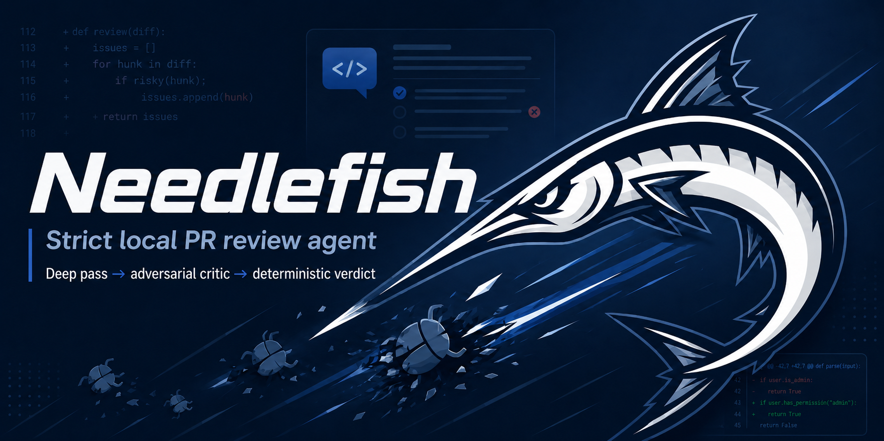

<p align="center">
  
</p>

# Needlefish

Needlefish reviews Git changes for defects before merge. A review pass and a
critic filter the findings. Fixed rules derive the final verdict.

[繁體中文](README.zh-TW.md) · [Quick start](#quick-start) ·
[Read the result](#read-the-result) · [Common errors](#common-errors) ·
[Benchmark page](https://frankekn.github.io/needlefish/) ·
[Full reference](https://github.com/frankekn/needlefish/blob/main/docs/reference.md)

## Quick start

Use a trusted Git repository. You need Node 20+, Git 2.41+, and an authenticated
`codex`, `claude`, or `opencode` CLI on `PATH`.
Run the published v0.4.11 CLI from the repository root.
The full reference describes current source behavior.

```bash
npx needlefish doctor
npx needlefish --dry-run
npx needlefish
```

`doctor` checks the environment without a model call. It prints a fix for each
failed check. An `unknown` authentication result does not prove model access.
Each runner status command has a 10-second hard timeout. A timed-out login
check is `unknown`. Interrupted diagnostics clean up their probe processes
and temporary directory.
`--dry-run` shows the review scope without a model call or cache write.
The final command sends the diff and inspected repository context to the selected
model provider.
Read the provider's data and billing terms before reviewing private code.

A dirty worktree reviews staged, unstaged, and eligible untracked changes.
A clean branch reviews merge-base to `HEAD`. Use `--base <ref>` to override
the detected base. Automatic resolution from a subdirectory to the repository
root is included in v0.4.11.

```bash
npx needlefish --uncommitted
npx needlefish --branch --base main
npx needlefish pr 123
```

`pr 123` reviews the PR ref and needs authenticated `gh`. Local mode prints
Markdown and caches JSON at `~/.cache/needlefish/<repo>/last-review.json`.
It does not post to GitHub or apply fixes. `--fix` is not implemented.
The [`--pr` flag and other modes](https://github.com/frankekn/needlefish/blob/main/docs/reference.md#usage) are documented separately.

Small reviews normally use two model calls, review plus critic. Large reviews
use one map call, multiple deep calls, and a critic. Repair or retry calls can
add cost. Docs-only changes skip the model. GitHub same-head dedupe can also
skip calls. `--recheck` forces a full review.

## Read the result

| Verdict | Meaning | Next step |
| --- | --- | --- |
| `changes_requested` | At least one P0, P1, or P2 finding remains. | Check the cited code and preconditions. Fix confirmed defects and review the new change. |
| `needs_human` | No blocking finding remains, but a residual risk has `blocks: true`. | Resolve the risk with a human reviewer. This is not a pass. |
| `pass` | No blocking finding or blocking residual remains. | Read the coverage notes and complete your normal checks. |

P3 findings are reported without blocking. Severity follows the existing
finding contract. A model's confidence or prose does not override the verdict.
A failed or cancelled review is not a pass.

Inspect each finding's file, line, explanation, suggested fix, and validation.
Read `checked`, `scopeCallouts`, and `coverageGaps` too. A scope callout only
names a changed file type. It does not prove a defect or complete coverage.
LFS pointer gaps mean the file content was not reviewed. A pass applies only
to the captured change and is not proof that the code has no defects.

For automation, use `--json` and the versioned
[`ReviewResult` schema](schemas/review-result.v1.schema.json).
Dry-run JSON has a different shape. See the
[machine interface](https://github.com/frankekn/needlefish/blob/main/docs/reference.md#machine-interface) for fields and outcomes.

## Common errors

| Symptom | Action |
| --- | --- |
| Node or Git check fails | Install Node 20+ or Git 2.41+, then run `doctor` again. |
| No runner is found | Install and authenticate `codex`, `claude`, or `opencode`, or explicitly select a configured runner. |
| Login, provider, quota, or network error | Read the runner diagnostic. Check that provider's login and account status. `doctor` does not prove quota or connectivity. |
| Folder is not a Git repository | Select the repository root, or run `git init` only if you intend to create a repository. |
| Base ref cannot be resolved | Fetch the intended base and pass `--base <ref>`. |
| GitHub review is skipped | Read `needlefish-skip` and the check. Closed, stale, same-head, and untrusted-author skips are not new reviews. |
| Review times out | Inspect the failure and runner logs. Set an appropriate timeout only after checking the cause. Do not treat missing output as a pass. |

The `openai` HTTP runner cannot inspect repository files. Use a recommended
CLI runner, such as `codex`, `claude`, or `opencode`, for any model review.
Refusal before a model call is part of the v0.4.11 guarantee.

[Timeouts and runner options](https://github.com/frankekn/needlefish/blob/main/docs/reference.md#runners) and
[GitHub authentication](https://github.com/frankekn/needlefish/blob/main/docs/reference.md#hosted-any-repo) contain the full details.

## GitHub Action

From an installed source checkout, preview a hosted workflow for your target repository.
Follow [development setup](https://github.com/frankekn/needlefish/blob/main/docs/reference.md#development) first.

```bash
pnpm review setup github --repo /path/to/repo
```

This command writes nothing. A repository administrator must review and add the
proposed workflow through a PR and set `NEEDLEFISH_CODEX_API_KEY` separately.
It does not create a setup PR, add a secret, enable a required check, or change
branch protection. After this version is published, the npm equivalent is
`npx needlefish setup github --repo /path/to/repo`.

The proposed workflow pins the action and Codex CLI. It rejects fork, bot, and
untrusted-author PRs before checkout. Do not use `pull_request_target` with it.
GitHub reviews use `COMMENT`, not formal approval. The authoritative
`Needlefish` check is success for `pass` and failure for `changes_requested`,
`needs_human`, or execution failure.

Read the [hosted and self-hosted reference](https://github.com/frankekn/needlefish/blob/main/docs/reference.md#github-action)
for secrets, supported hosted runners, permissions, and operator-managed bundles.
### Guided GitHub setup

Guided setup is an unreleased source preview shared by the CLI and macOS app.
Read [the desktop setup instructions](https://github.com/frankekn/needlefish/blob/main/desktop/macos/README.md#enable-github-review).
From an installed source checkout, use the same setup owner:

```bash
pnpm review setup github login --confirm
pnpm review setup github repositories --json
pnpm review setup github status --repository owner/repo --json
pnpm review setup github create-pr --repository owner/repo --confirm --json
```

`create-pr` creates or reuses one owned branch and PR. It never merges the PR,
pushes the default branch, or edits branch protection. Customized Needlefish
workflows and unrecognized setup branches cause a conflict. Unrelated custom
workflows that setup can inspect are preserved and do not block setup.
If setup cannot inspect a workflow's contents, it stops without writing changes.
Ask a repository administrator to inspect that workflow before retrying.
Read the workflow and OpenAI code-disclosure/cost notice from `status` before consent.

`set-secret --repository owner/repo --confirm --replace-secret` accepts the
credential only through stdin. Use the desktop secure field or a trusted secret
manager that writes directly to the pipe. Never put the credential in shell
arguments, history, a file, or a URL. GitHub secret writes are unconditional.
`--replace-secret` accepts replacing a value another administrator may have created.
A secret update leaves AI authentication and the first review unverified.
Real first-review and novice-admin acceptance remain open in #151.

## Runners

The CLI accepts `codex`, `claude`, `opencode`, `openai`, `grok`, `pi`, and `acp`.
Auto-detection checks only Codex, Claude Code, then opencode. Adapter support is
not qualification of every model, provider route, account, or CLI version.
The hosted action installs only Codex, Claude Code, opencode, or pi.

CLI models run unrestricted in a disposable clone with GitHub tokens stripped,
fixed `HEAD`, no origin remote, and post-call mutation checks. This clone is not
an OS sandbox. A runner that learns another local path can still access it.
Only review trusted projects on an appropriate machine.
See [runner configuration and isolation](https://github.com/frankekn/needlefish/blob/main/docs/reference.md#runners),
[connections](https://github.com/frankekn/needlefish/blob/main/docs/connections.md), and [ACP startup](https://github.com/frankekn/needlefish/blob/main/docs/acp-startup.md).

## macOS preview

The [native app source preview](https://github.com/frankekn/needlefish/blob/main/desktop/macos/README.md) supports macOS 14+
on Apple silicon. It calls the existing CLI for a trusted local project.
It is not a qualified end-user download. Signing, notarization, clean-machine
tests, exact-lane qualification, and novice trials remain release gates.

## Reference and development

[Full CLI and GitHub reference](https://github.com/frankekn/needlefish/blob/main/docs/reference.md) contains all modes, result
fields, auth variables, subprocess environment, self-managed installation,
and development commands. [Methodology](https://github.com/frankekn/needlefish/blob/main/eval/RESULTS.md),
[experiment history](https://github.com/frankekn/needlefish/blob/main/eval/RESULTS_HISTORY.md), and [raw reports](https://github.com/frankekn/needlefish/tree/main/eval/results)
keep benchmark evidence separate from installation instructions.

## Benchmarks

The [benchmark page](https://frankekn.github.io/needlefish/) and the table below
use guarded reports. Compare rows only when their prompt, fixture-set, scorer,
and anti-cheat identities match. Provider failures are operational outcomes.
Historical results do not qualify the current installation or desktop preview.
[Column definitions and historical notes](https://github.com/frankekn/needlefish/blob/main/docs/reference.md#historical-benchmark-notes)
remain in the reference.

The generator currently writes the full table into both READMEs. The generated
block stays here unchanged so future publication uses the same source of truth.

<!-- benchmark:begin -->
<!-- generated by eval/gen-readme.ts from eval/leaderboard.json and eval/results/*.json — do not hand-edit -->

**Updated 2026-11-28** — measured 2026-09-06 to 2026-11-27; all 23 published lanes at 87 scenarios × 3 draws, sealed holdouts included, Class R gate, anti-cheat v2; baseline commit `a5a0c68`, prompt `e62d0889fc704541`, fixture set `2327f9134a425a4f`, scorer `8bbc6152d8b45a43`; every report has `cheatDetectedCount: 0`.

Scoring v2: positive fixtures are macro-averaged over the frozen families, negative fixtures remain equally weighted, and both sides count 50%. Tier-1, anti-cheat, and positive noise remain separate gates.

Each model shows its latest scored run. The model ID is the value passed to the harness. Expand a model on the benchmark page to find earlier runs.

**Ranked lanes.** **Deployed lane: DeepSeek V4.1 Flash (`deepseek-v4.1-flash-expires-on-0910` at `high` effort)** — the deployed lane recorded in the leaderboard; which lane actually runs is decided by workflow inputs and by any self-managed runner bundle. Bold marks the deployed lane and the best value in each column.

| Rank | Model | Model ID | Harness | Effort | Balanced | 95% CI | Tier-1 | FP | Noise/review | Mean |
| ---: | --- | --- | --- | --- | ---: | ---: | ---: | ---: | ---: | ---: |
| 1 | [Claude Opus 5.5](https://github.com/frankekn/needlefish/blob/main/eval/results/2026-11-21-public87-opus-x3.json) | `claude-opus-5-5` | Pi 1.6.0 | medium | **96.03%** | 92.8%–99.3% | 100% | 0.00% | 0.060 | 28s |
| 1 | [DeepSeek V4.1 Flash](https://github.com/frankekn/needlefish/blob/main/eval/results/2026-11-21-public87-deepseek-v4.1-flash-high-x3.json) | `deepseek-v4.1-flash` | Pi 1.6.0 | high | 95.93% | 92.9%–98.9% | 100% | 1.39% | 0.038 | 30s |
| 1 | [Qwen 3.8 Flash](https://github.com/frankekn/needlefish/blob/main/eval/results/2026-09-09-pi-qwen38-flash-max-x3.json) | `qwen3.8-flash` | Pi 0.85.1 | max | 95.54% | 92.4%–98.7% | 95% | 0.00% | 0.049 | 118s |
| 1 | [Grok 4.6](https://github.com/frankekn/needlefish/blob/main/eval/results/2026-09-06-grok-grok46-xhigh-x3.json) | `grok-4.6` | Grok CLI 1.0.13 | xhigh | 95.34% | 91.8%–98.8% | 100% | 1.39% | 0.011 | 230s |
| 1 | [Grok 4.7](https://github.com/frankekn/needlefish/blob/main/eval/results/2026-09-22-grok-47-high-x3.json) | `grok-4.7` | grok 1.0.40 | high | 95.34% | 91.9%–98.7% | 100% | 1.39% | 0.038 | 255s |
| 1 | [Inkling 2 Mini](https://github.com/frankekn/needlefish/blob/main/eval/results/2026-11-27-public87-inkling-2-mini-high-x3.json) | `inkling-2-mini` | Pi 1.6.1 | high | 95.34% | 92.2%–98.5% | 100% | 1.39% | 0.011 | 256s |
| 1 | [GLM-5.3-Flash](https://github.com/frankekn/needlefish/blob/main/eval/results/2026-09-09-pi-glm53-flash-max-x3.json) | `glm-5.3-flash` | Pi 0.85.1 | max | 95.24% | 91.9%–98.5% | 100% | 1.39% | 0.033 | 208s |
| 1 | [Claude Sonnet 5.5](https://github.com/frankekn/needlefish/blob/main/eval/results/2026-11-21-public87-sonnet-x3.json) | `claude-sonnet-5-5` | Pi 1.6.0 | high | 95.04% | 91.5%–98.5% | 100% | 0.00% | 0.011 | **22s** |
| 9 | [GPT-5.6 Terra](https://github.com/frankekn/needlefish/blob/main/eval/results/2026-09-09-pi-gpt56-terra-xhigh-x3.json) | `gpt-5.6-terra` | Pi 0.85.1 | xhigh | 91.37% | 86.3%–96.5% | 95% | 6.94% | 0.077 | 76s |
| 9 | [DeepSeek V4 Flash Vision Exp](https://github.com/frankekn/needlefish/blob/main/eval/results/2026-09-06-pi-cliproxy-deepseek-v4-flash-vision-exp-max-x3.json) | `deepseek/deepseek-v4-flash-vision-exp` | Pi 0.85.1 | max | 91.17% | 87.0%–95.4% | 95% | 1.39% | 0.022 | 116s |
| 9 | [Muse Wonder 1.0](https://github.com/frankekn/needlefish/blob/main/eval/results/2026-10-13-muse-code-wonder-1.0-high-ranked-x3.json) | `muse-wonder-1.0` | Muse Code 1.4.7 (1.4.7-R6101.1) | high | 90.67% | 84.1%–97.2% | 100% | 12.50% | 0.055 | 36s |
| 9 | [GPT-6 Luna](https://github.com/frankekn/needlefish/blob/main/eval/results/2026-09-23-codex-gpt6-luna-max-x3.json) | `gpt-6-luna` | Codex CLI 0.156.0 | max | 89.09% | 82.4%–95.8% | 95% | 6.94% | 0.087 | 129s |
| 9 | [GPT-5.6 Sol](https://github.com/frankekn/needlefish/blob/main/eval/results/2026-09-06-codex-gpt56-sol-medium-x3.json) | `gpt-5.6-sol` | Codex CLI 0.153.4 | medium | 88.29% | 81.0%–95.6% | 100% | 13.89% | 0.071 | 75s |

**Unranked lanes**, same run — the interim gate requires at least 20/21 Tier-1 successes, at least 2/3 on every fixture, and positive noise no higher than 0.12; a later x3 confirmation is recorded but does not restore the rank.

| Model | Model ID | Harness | Effort | Balanced | Gate missed in the full report |
| --- | --- | --- | --- | ---: | --- |
| [GPT-6 Sol](https://github.com/frankekn/needlefish/blob/main/eval/results/2026-09-23-codex-gpt6-sol-medium-x3.json) | `gpt-6-sol` | Codex CLI 0.156.0 | medium | 89.98% | noise 0.153 > 0.12 |
| [GPT-5.6 Luna](https://github.com/frankekn/needlefish/blob/main/eval/results/2026-09-06-codex-gpt56-luna-max-x3.json) | `gpt-5.6-luna` | Codex CLI 0.153.4 | max | 88.49% | Tier-1 76.19%: `t1-inverted-guard` 0/3, `real-pr1-codex-no-sandbox-flag` 2/3, `real-pr1-self-review-tool-checkout` 2/3; noise 0.1311 > 0.12 |
| [GPT-6.1 Terra](https://github.com/frankekn/needlefish/blob/main/eval/results/2026-11-21-public87-terra-x3.json) | `codex/gpt-6.1-terra` | Pi 1.6.0 | high | 87.70% | noise 0.2295 > 0.12 |
| [GPT-6.2 Sol](https://github.com/frankekn/needlefish/blob/main/eval/results/2026-11-21-public87-sol-x3.json) | `codex/gpt-6.2-sol` | Pi 1.6.0 | medium | 86.41% | noise 0.2404 > 0.12 |

1 lane(s) had provider or infrastructure failures and are excluded from scoring; see the benchmark page and eval/RESULTS.md.
<!-- benchmark:end -->
