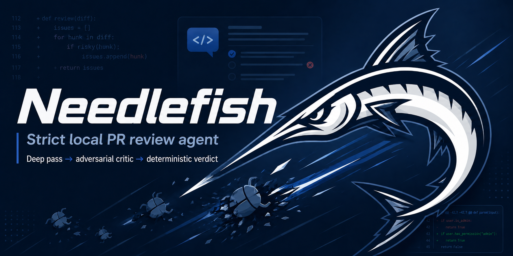

<p align="center">
  
</p>

# Needlefish

Needlefish 在 merge 前審查 Git 變更中的缺陷。審查與 critic 篩選 finding，
最後由固定規則推導 verdict。

[English](README.md) · [快速開始](#快速開始) · [讀取結果](#讀取結果) ·
[常見錯誤](#常見錯誤) · [Benchmark 頁面](https://frankekn.github.io/needlefish/) ·
[完整參考](https://github.com/frankekn/needlefish/blob/main/docs/reference.zh-TW.md)

## 快速開始

使用可信任的 Git repo。需要 Node 20 以上、Git 2.41 以上，以及已登入的
`codex`、`claude` 或 `opencode` CLI，並讓 CLI 位於 `PATH`。

```bash
npx needlefish doctor
npx needlefish --dry-run
npx needlefish
```

`doctor` 不呼叫模型，只檢查環境，並為失敗項目列出修正方式。
認證結果為 `unknown` 不代表模型可用。`--dry-run` 不呼叫模型、不寫快取，
只顯示審查範圍。最後一個指令會把 diff 與檢查到的 repo 內容送到所選模型供應商。
審查私有程式碼前，先閱讀供應商的資料與計費條款。

Worktree 有變更時，會審查 staged、unstaged 與符合收集條件的 untracked
變更。乾淨 branch 則審查 merge-base 到 `HEAD`。選擇子目錄仍會審查整個
repo。使用 `--base <ref>` 可指定基準。

```bash
npx needlefish --uncommitted
npx needlefish --branch --base main
npx needlefish pr 123
```

`pr 123` 審查 PR ref，需要已登入的 `gh`。本機模式輸出 Markdown，並將
JSON 快取於 `~/.cache/needlefish/<repo>/last-review.json`。
本機模式不發布到 GitHub，也不套用修正。`--fix` 尚未實作。
[`--pr` flag 與其他模式](docs/reference.zh-TW.md#使用方式) 另有完整說明。

小型審查通常呼叫模型兩次，分別是 review 與 critic。大型審查使用一次 map、
多次 deep 與一次 critic。修復輸出格式或重試可能增加費用。純文件變更會跳過
模型，GitHub same-head dedupe 也可能省略呼叫。`--recheck` 會強制完整重審。

## 讀取結果

| Verdict | 意義 | 下一步 |
| --- | --- | --- |
| `changes_requested` | 至少保留一項 P0、P1 或 P2 finding。 | 檢查引用的程式碼與觸發條件，修正確認的缺陷，再審查新變更。 |
| `needs_human` | 沒有阻擋 finding，但有 `blocks: true` 的殘餘風險。 | 由人工釐清風險。這不是通過。 |
| `pass` | 沒有阻擋 finding 或阻擋殘餘風險。 | 閱讀覆蓋說明，完成原有檢查。 |

P3 finding 仍會列出，但不阻擋。Severity 沿用既有 finding 契約。
模型的 confidence 或文字不會覆寫 verdict。失敗或取消的審查不是通過。

逐項檢查 finding 的檔案、行號、解釋、建議修正與 validation。
也要閱讀 `checked`、`scopeCallouts` 與 `coverageGaps`。Scope callout 只列出
變更檔案的類型，不證明缺陷或完整覆蓋。LFS pointer gap 代表檔案內容未被
審查。Pass 只適用於擷取的變更，不保證程式沒有缺陷。

自動化使用 `--json` 與帶版本的
[`ReviewResult` schema](schemas/review-result.v1.schema.json)。
Dry-run JSON 的格式不同。欄位與 outcome 詳見
[機器介面](docs/reference.zh-TW.md#機器介面)。

## 常見錯誤

| 現象 | 處理方式 |
| --- | --- |
| Node 或 Git 檢查失敗 | 安裝 Node 20 以上或 Git 2.41 以上，再執行 `doctor`。 |
| 找不到 runner | 安裝並登入 `codex`、`claude` 或 `opencode`，或明確指定已設定的 runner。 |
| 登入、供應商、額度或網路錯誤 | 閱讀 runner 診斷，確認該供應商的登入與帳戶狀態。`doctor` 不證明額度或連線可用。 |
| 資料夾不是 Git repo | 選擇 repo 根目錄。只有確定要建立新 repo 時才執行 `git init`。 |
| 無法解析 base ref | Fetch 所需基準，再指定 `--base <ref>`。 |
| `openai` runner 拒絕 deep 審查 | 改用有工具能力的 CLI runner。HTTP runner 只支援小型完整 diff 審查。 |
| GitHub 審查被跳過 | 閱讀 `needlefish-skip` 與 check。Closed、stale、same-head 與 untrusted-author skip 都不是新的審查。 |
| 審查逾時 | 檢查故障與 runner log，確認原因後才調整 timeout。缺少輸出不能當成通過。 |

完整細節見 [timeout 與 runner 選項](docs/reference.zh-TW.md#runners) 及
[GitHub 認證](docs/reference.zh-TW.md#hosted任何-repo)。

## GitHub Action

在安裝完成的原始碼 checkout 內，預覽目標 repo 的 hosted workflow。
先完成[開發環境安裝](docs/reference.zh-TW.md#開發環境安裝)。

```bash
pnpm review setup github --repo /path/to/repo
```

此指令不寫入任何內容。Repo 管理員仍須透過經審查的 PR 加入 workflow，
並另外設定 `NEEDLEFISH_CODEX_API_KEY`。它不建立 setup PR、不新增 secret、
不設定 required check，也不變更 branch protection。此版本發布後，npm
對應指令為 `npx needlefish setup github --repo /path/to/repo`。

提案會固定 action 與 Codex CLI 版本，並在 checkout 前拒絕 fork、bot 與
非信任作者的 PR。不要搭配 `pull_request_target`。
GitHub review 使用 `COMMENT`，不是正式 approval。權威的 `Needlefish`
check 對 `pass` 顯示 success，對 `changes_requested` 或執行失敗顯示
failure，對 `needs_human` 顯示 neutral。Neutral 不是通過。

Secret、hosted 支援的 runner、權限與操作者管理的 bundle 詳見
[hosted 與 self-hosted 參考](docs/reference.zh-TW.md#github-action)。
另一份[引導設定 Draft 預覽](https://github.com/frankekn/needlefish/pull/280)
不屬於此處說明的已合併 CLI。

## Runners

CLI 接受 `codex`、`claude`、`opencode`、`openai`、`grok`、`pi` 與 `acp`。
自動偵測只依序檢查 Codex、Claude Code 與 opencode。支援 adapter 不代表
每個模型、供應商路徑、帳戶或 CLI 版本都已通過資格驗證。
Hosted action 只安裝 Codex、Claude Code、opencode 或 pi。

CLI 模型不受程序權限限制，在 disposable clone 執行。GitHub token 已移除，
`HEAD` 固定，沒有 origin remote，每次呼叫後檢查是否變更。
這不是 OS sandbox。Runner 若得知其他本機路徑，仍可能存取該路徑。
只在適當機器上審查可信任的專案。詳見
[runner 設定與隔離](docs/reference.zh-TW.md#runners)、
[connections](docs/connections.md) 與 [ACP 啟動](docs/acp-startup.md)。

## macOS 預覽

[原生 app 原始碼預覽](desktop/macos/README.md) 支援 Apple silicon 的
macOS 14 以上，透過既有 CLI 審查可信任的本機專案。
這不是已通過資格驗證的終端使用者下載版。簽章、公證、clean-machine 測試、
精確 lane 驗證與新手試用仍是 release gate。

## 參考與開發

[完整 CLI 與 GitHub 參考](docs/reference.zh-TW.md) 收錄所有模式、結果欄位、
認證變數、subprocess 環境、自管安裝與開發指令。
[方法](eval/RESULTS.md)、[實驗歷史](eval/RESULTS_HISTORY.md) 與
[原始報告](eval/results/) 將 benchmark 證據與安裝指引分開。

## Benchmarks

[Benchmark 頁面](https://frankekn.github.io/needlefish/) 與下表使用受防護的
report。只有 prompt、fixture-set、scorer 與 anti-cheat identity 相同的列
才能比較。Provider failure 屬於執行結果。歷史分數不代表目前安裝或 desktop
預覽已通過資格驗證。[欄位定義與歷史解讀](docs/reference.zh-TW.md#歷史-benchmark-記錄)
保留於參考文件。

Generator 目前會把完整表格寫入兩語 README。以下產生區塊維持原樣，讓後續
發布沿用相同資料來源。

<!-- benchmark:begin -->
<!-- generated by eval/gen-readme.ts from eval/leaderboard.json and eval/results/*.json — do not hand-edit -->

**更新於 2026-10-13**——量測於 2026-09-06 至 2026-10-13；全部 17 條公開 lane 各跑 87 個情境 × 3 次，包含 sealed holdout，Class R gate，anti-cheat v2；baseline commit `a5a0c68`，prompt `e62d0889fc704541`，fixture set `e9923bbc7753a04a`，scorer `8bbc6152d8b45a43`；每份 report 皆為 `cheatDetectedCount: 0`。

**排名 lane。** **目前部署 lane：DeepSeek V4.1 Flash（`deepseek-v4.1-flash-expires-on-0910` @ `high`）**——leaderboard 記錄的部署 lane；實際執行哪一條，由 workflow input 與自管 runner bundle 決定。粗體標示目前部署的 lane 與每欄最佳值。

| 名次 | Lane | Harness | Effort | Balanced | 95% CI | Tier-1 | FP | Noise/review | 平均 |
| ---: | --- | --- | --- | ---: | ---: | ---: | ---: | ---: | ---: |
| 1 | **[DeepSeek V4.1 Flash](https://github.com/frankekn/needlefish/blob/main/eval/results/2026-09-09-pi-deepseek-v41-flash-high-x3.json)（目前部署）** | Pi 0.85.1 | high | **97.81%** | 95.6%–100.0% | 100% | 0.00% | 0.027 | **31s** |
| 1 | [Qwen 3.8 Flash](https://github.com/frankekn/needlefish/blob/main/eval/results/2026-09-09-pi-qwen38-flash-max-x3.json) | Pi 0.85.1 | max | 95.63% | 92.7%–98.6% | 95% | 0.00% | 0.055 | 118s |
| 1 | [Grok 4.6](https://github.com/frankekn/needlefish/blob/main/eval/results/2026-09-06-grok-grok46-xhigh-x3.json) | Grok CLI 1.0.13 | xhigh | 95.48% | 92.2%–98.8% | 100% | 1.39% | **0.011** | 230s |
| 1 | [Grok 4.7](https://github.com/frankekn/needlefish/blob/main/eval/results/2026-09-22-grok-47-high-x3.json) | grok 1.0.40 | high | 95.48% | 92.3%–98.7% | 100% | 1.39% | 0.038 | 255s |
| 5 | [GLM-5.3-Flash](https://github.com/frankekn/needlefish/blob/main/eval/results/2026-09-09-pi-glm53-flash-max-x3.json) | Pi 0.85.1 | max | 94.93% | 91.6%–98.3% | 100% | 1.39% | 0.038 | 208s |
| 5 | [GLM-5.3-Flash](https://github.com/frankekn/needlefish/blob/main/eval/results/2026-09-06-pi-zai-glm53-flash-max-x3.json) | Pi 0.85.1 | max | 94.81% | 91.5%–98.1% | 95% | 0.00% | 0.022 | 164s |
| 7 | [DeepSeek V4 Flash Vision Exp](https://github.com/frankekn/needlefish/blob/main/eval/results/2026-09-06-pi-cliproxy-deepseek-v4-flash-vision-exp-max-x3.json) | Pi 0.85.1 | max | 91.66% | 87.7%–95.6% | 95% | 1.39% | 0.022 | 116s |
| 7 | [GPT-5.6 Terra](https://github.com/frankekn/needlefish/blob/main/eval/results/2026-09-09-pi-gpt56-terra-xhigh-x3.json) | Pi 0.85.1 | xhigh | 91.61% | 86.7%–96.5% | 95% | 6.94% | 0.077 | 76s |
| 7 | [Muse Wonder 1.0](https://github.com/frankekn/needlefish/blob/main/eval/results/2026-10-13-muse-code-wonder-1.0-high-ranked-x3.json) | Muse Code 1.4.7 (1.4.7-R6101.1) | high | 90.47% | 83.9%–97.0% | 100% | 12.50% | 0.060 | 36s |
| 7 | [GPT-5.6 Terra](https://github.com/frankekn/needlefish/blob/main/eval/results/2026-09-06-codex-gpt56-terra-high-x3.json) | Codex CLI 0.153.4 | high | 89.95% | 83.8%–96.1% | 100% | 9.72% | 0.077 | 63s |
| 7 | [GPT-6 Luna](https://github.com/frankekn/needlefish/blob/main/eval/results/2026-09-23-codex-gpt6-luna-max-x3.json) | Codex CLI 0.156.0 | max | 89.40% | 82.9%–95.9% | 95% | 6.94% | 0.087 | 129s |
| 7 | [GPT-5.6 Sol](https://github.com/frankekn/needlefish/blob/main/eval/results/2026-09-06-codex-gpt56-sol-medium-x3.json) | Codex CLI 0.153.4 | medium | 88.41% | 81.1%–95.7% | 100% | 13.89% | 0.077 | 75s |
| 7 | [GPT-6 Luna](https://github.com/frankekn/needlefish/blob/main/eval/results/2026-09-23-codex-gpt6-luna-xhigh-x3.json) | Codex CLI 0.156.0 | xhigh | 87.76% | 80.7%–94.8% | 100% | 8.33% | 0.060 | 102s |

**未排名 lane**，同批量測——目前 interim gate 要求 Tier-1 共 21 draws 至少成功 20 次、每個 fixture 至少 2/3，且 positive noise 不超過 0.12；事後 x3 確認僅作記錄，不恢復名次。

| Lane | Balanced | 完整報告未過的門檻 |
| --- | ---: | --- |
| [GPT-5.6 Terra](https://github.com/frankekn/needlefish/blob/main/eval/results/2026-09-06-codex-gpt56-terra-xhigh-x3.json) xhigh | 90.39% | Tier-1 90.48%: `real-pr1-self-review-tool-checkout` 2/3, `t1-inverted-guard` 2/3; noise 0.1202 > 0.12 |
| [GPT-6 Sol](https://github.com/frankekn/needlefish/blob/main/eval/results/2026-09-23-codex-gpt6-sol-medium-x3.json) medium | 89.97% | noise 0.153 > 0.12 |
| [GPT-5.6 Luna](https://github.com/frankekn/needlefish/blob/main/eval/results/2026-09-06-codex-gpt56-luna-max-x3.json) max | 88.43% | Tier-1 76.19%: `t1-inverted-guard` 0/3, `real-pr1-codex-no-sandbox-flag` 2/3, `real-pr1-self-review-tool-checkout` 2/3; noise 0.1311 > 0.12 |

1 條 lane 因 provider 或基礎設施故障而不計分；詳見 benchmark 頁面與 eval/RESULTS.md。
<!-- benchmark:end -->
